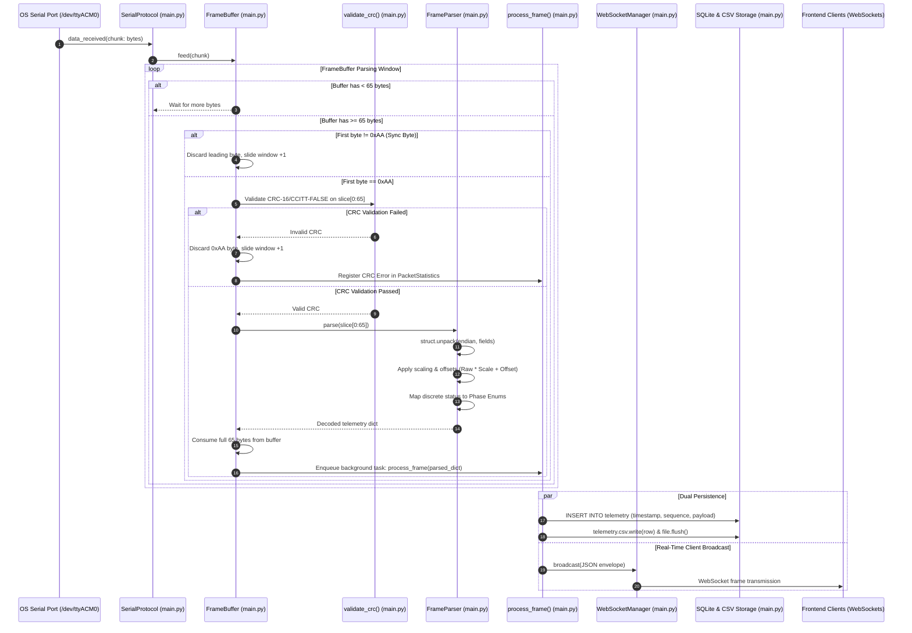
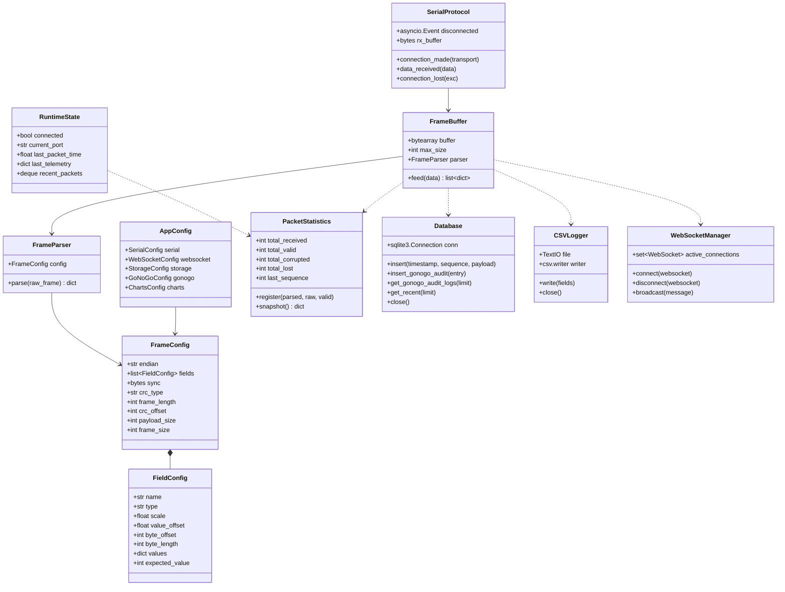
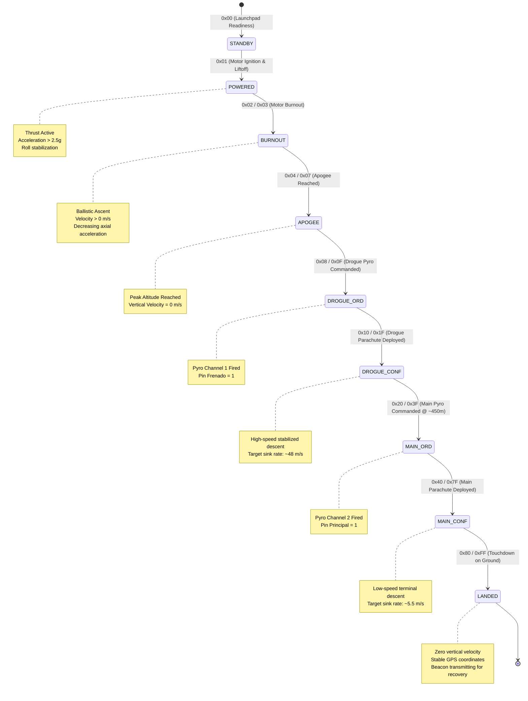
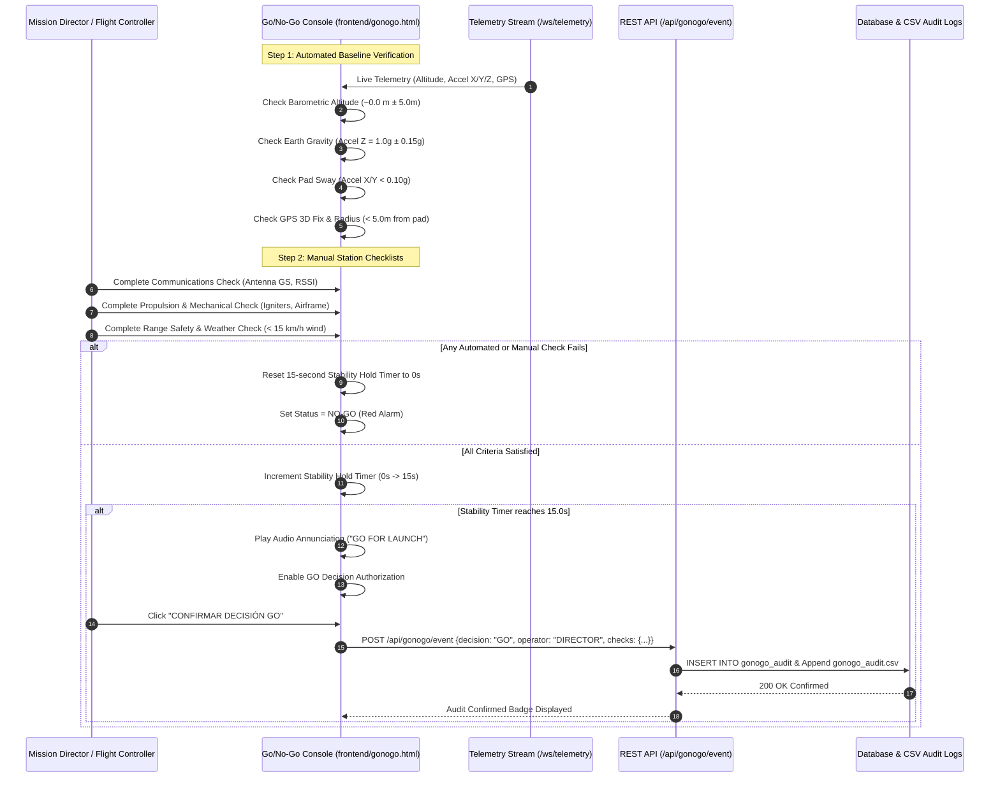
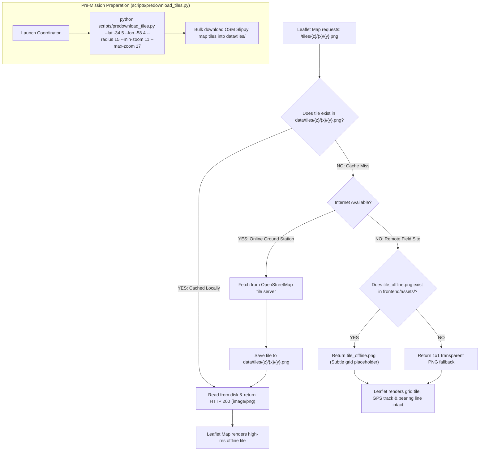
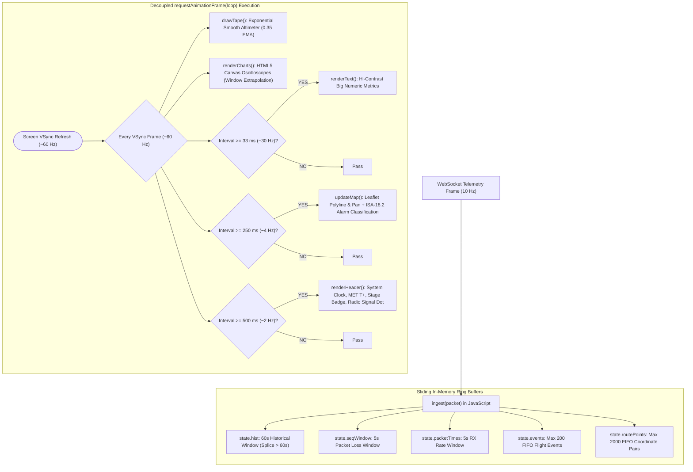

# Rocket Ground Station — Comprehensive Architectural Diagrams & Deep-Dive Reference

> **Language / Idioma:** [ 🇬🇧 English ](architecture-diagrams.md)
> **Companion Document:** [System Architecture](architecture.md) | [Binary Protocol](protocol.md) | [Frame Schema](frame-schema.md)

This document provides a complete visual and technical walkthrough of the **Rocket Telemetry Ground Station** (`estacion-terrena-pc`) codebase. It details the internal software architecture, asynchronous event loop, binary decoding engine, fault tolerance mechanisms, persistence layers, and frontend rendering pipelines through structured Mermaid diagrams.

---

## Table of Contents
1. [End-to-End System & Component Topology](#1-end-to-end-system--component-topology)
2. [Data Ingestion & Binary Frame Parsing Engine](#2-data-ingestion--binary-frame-parsing-engine)
3. [Asynchronous Concurrency & Task Lifecycle](#3-asynchronous-concurrency--task-lifecycle)
4. [Backend Object-Oriented Domain Model](#4-backend-object-oriented-domain-model)
5. [Rocket Flight State Machine & Telemetry Mapping](#5-rocket-flight-state-machine--telemetry-mapping)
6. [Pre-Flight Go / No-Go Qualification & Audit Pipeline](#6-pre-flight-go--no-go-qualification--audit-pipeline)
7. [Offline GIS Tile Ingestion & Fallback Hierarchy](#7-offline-gis-tile-ingestion--fallback-hierarchy)
8. [Frontend Multi-View Architecture & Decoupled RAF Loop](#8-frontend-multi-view-architecture--decoupled-raf-loop)
9. [Source Code Map & Direct References](#9-source-code-map--direct-references)

---

## 1. End-to-End System & Component Topology

The system is architected as an asynchronous, single-process micro-service written in Python 3.11+ using **FastAPI** and **uvicorn**, communicating with hardware via **pyserial-asyncio** and with client browsers via **WebSockets**.

```mermaid
flowchart TD
    subgraph HW["Hardware & Physical Transceiver Layer"]
        ROCKET["Rocket Flight Avionics (BMP280, MPU6050, GPS)"]
        LORA_AIR["LoRa 433 MHz Air Link (SF7, BW 250kHz, CR 4/5)"]
        GS_RADIO["Ground Station LoRa Modem (SX1278 / SiK)"]
        UART["USB-UART Serial Bus (/dev/ttyACM0 / COMx @ 115200 8N1)"]
        
        ROCKET -->|RF Telemetry| LORA_AIR
        LORA_AIR -->|RF Packets| GS_RADIO
        GS_RADIO -->|Transparent Serial Stream| UART
    end

    subgraph BACKEND["FastAPI Backend (main.py)"]
        subgraph INGESTION["Serial Acquisition & Protocol"]
            SER_PROTO["SerialProtocol (asyncio.Protocol)"]
            FRAME_BUF["FrameBuffer (Sliding Byte Window)"]
            FRAME_PARSER["FrameParser Engine (Declarative Unpacker)"]
        end

        subgraph CONFIG["Declarative Configuration (YAML)"]
            CFG_APP["config/app.yaml (Serial, GoNoGo, Charts)"]
            CFG_FRAME["config/frame.yaml (Fields, Endianness, CRC-16)"]
        end

        subgraph PIPELINE["process_frame() Dispatcher"]
            STAT["PacketStatistics (Rx, CRC Errors, Loss, Health)"]
            WS_MGR["WebSocketManager (Concurrent Broadcaster)"]
            DB_STORAGE["Database (SQLite3 WAL Mode)"]
            CSV_STORAGE["CSVLogger (Immediate Flush Flat-File)"]
            AUDIT_STORAGE["GoNoGoCSVLogger & DB Audit Table"]
        end

        subgraph HTTP_SRV["FastAPI Web & REST Endpoints"]
            REST_API["REST Router (/api/status, /api/history, /api/config)"]
            WS_ENDPOINT["WebSocket Endpoint (/ws/telemetry)"]
            TILE_SERVER["Tile Server (/tiles/{z}/{x}/{y}.png)"]
            STATIC_SRV["StaticFiles Mounter (/frontend)"]
        end

        UART -->|data_received()| SER_PROTO
        SER_PROTO -->|feed() bytes| FRAME_BUF
        CFG_FRAME -.->|Loads Rules| FRAME_PARSER
        CFG_APP -.->|Loads Settings| BACKEND
        FRAME_BUF -->|Raw 65B Candidate| FRAME_PARSER
        FRAME_PARSER -->|Decoded Dict| PIPELINE
        
        PIPELINE --> STAT
        PIPELINE --> WS_MGR
        PIPELINE --> DB_STORAGE
        PIPELINE --> CSV_STORAGE
        REST_API --> DB_STORAGE
        TILE_SERVER --> TILE_CACHE[("data/tiles/ (Local GIS Cache)")]
    end

    subgraph CLIENTS["Frontend Web Application Suite (HTML5 / ES6)"]
        INDEX_HTML["Primary Mission Dashboard (frontend/index.html)"]
        GONOGO_HTML["Pre-Flight Go/No-Go Console (frontend/gonogo.html)"]
        RECOVERY_HTML["Tactical Search & Recovery View (frontend/recovery.html)"]
        COMMON_JS["Shared Utility Suite (frontend/js/common.js)"]
        DEMO_ENGINE["Embedded Synthetic Simulator (Demo Mode)"]

        WS_MGR -->|ws://host:8000/ws/telemetry| INDEX_HTML
        WS_MGR -->|ws://host:8000/ws/telemetry| GONOGO_HTML
        WS_MGR -->|ws://host:8000/ws/telemetry| RECOVERY_HTML
        REST_API -->|HTTP GET /api/history| INDEX_HTML
        REST_API -->|HTTP POST /api/gonogo/event| GONOGO_HTML
        TILE_SERVER -->|Map Imagery| INDEX_HTML
        TILE_SERVER -->|Map Imagery| RECOVERY_HTML
        COMMON_JS -.->|Provides State & Formats| INDEX_HTML
        COMMON_JS -.->|Provides State & Formats| GONOGO_HTML
        COMMON_JS -.->|Provides State & Formats| RECOVERY_HTML
        DEMO_ENGINE -.->|Offline Fallback Simulation| COMMON_JS
    end
```

---

## 2. Data Ingestion & Binary Frame Parsing Engine

The telemetry acquisition loop avoids thread-blocking polling by utilizing Python's `asyncio.Protocol`. The sliding buffer inspects byte streams dynamically, re-synchronizing cleanly when noise or dropped bytes occur.



---

## 3. Asynchronous Concurrency & Task Lifecycle

The backend operates entirely on a single-threaded cooperative event loop (`asyncio`). To prevent garbage collection of pending coroutines and handle hardware disconnects seamlessly, it implements explicit background task tracking and a continuous reconnection state machine.

```mermaid
flowchart TD
    START(["Application Startup"]) --> LOAD_CFG["Load YAML Configurations (app.yaml, frame.yaml)"]
    LOAD_CFG --> INIT_DB["Initialize SQLite WAL Mode & Open CSV Handles"]
    INIT_DB --> SPAWN_SERIAL["asyncio.create_task(serial_loop)"]

    subgraph SERIAL_FSM["serial_loop() Lifecycle & Auto-Reconnect"]
        TRY_CONN["Resolve Serial Port (/dev/ttyACM0 or COMx)"] --> OPEN_CONN["serial_asyncio.create_serial_connection()"]
        OPEN_CONN -->|Success| CONN_ACTIVE["Protocol Active & Listening"]
        OPEN_CONN -->|Failure / Port Busy| WAIT_RETRY["Sleep reconnect_delay (3s)"]
        WAIT_RETRY --> TRY_CONN

        CONN_ACTIVE --> WAIT_DISC["await protocol.disconnected.wait()"]
        WAIT_DISC -->|Port Disconnected / Cable Pulled| ON_LOST["connection_lost() Callback Triggered"]
        ON_LOST --> BROADCAST_DISC["Broadcast {'connected': false} via WebSockets"]
        BROADCAST_DISC --> WAIT_RETRY
    end

    subgraph TASK_MANAGER["create_background_task() GC Guard"]
        ENQUEUE_TASK["Frame Received: process_frame() Coroutine"] --> CREATE_TASK["task = asyncio.create_task(coro)"]
        CREATE_TASK --> ADD_SET["background_tasks.add(task)"]
        ADD_SET --> ADD_CALLBACK["task.add_done_callback(background_tasks.discard)"]
        ADD_CALLBACK --> EXEC_TASK["Execute Frame Processing & Broadcasting"]
        EXEC_TASK --> ON_DONE["Task Completed: Set Cleanly Discards Task"]
    end

    subgraph SHUTDOWN_HANDLER["Graceful Shutdown (@app.on_event('shutdown'))"]
        STOP_SIGNAL(["SIGINT / SIGTERM / System Exit"]) --> CANCEL_TASKS["Cancel pending background_tasks"]
        CANCEL_TASKS --> GATHER_WAIT["await asyncio.gather(*tasks, return_exceptions=True)"]
        GATHER_WAIT --> CLOSE_DB["Close SQLite connection (Commit WAL)"]
        CLOSE_DB --> FLUSH_CSV["Flush and close telemetry.csv & gonogo_audit.csv"]
        FLUSH_CSV --> TERMINATE(["Process Exit 0"])
    end
```



---

## 4. Backend Object-Oriented Domain Model

The core architecture in `main.py` is cleanly segregated into immutable dataclass configurations, stateful buffers, protocol handlers, and persistent storage abstractions.



---

## 5. Rocket Flight State Machine & Telemetry Mapping

The 65-byte definitive telemetry frame encodes flight status into byte 7 as a discrete state machine identifier. Both backend and frontend map these codes into standardized operational flight phases.



---

## 6. Pre-Flight Go / No-Go Qualification & Audit Pipeline

Prior to motor ignition, `frontend/gonogo.html` enforces a strict launch criteria evaluation protocol. It continuously audits live launchpad sensor telemetry against `config/app.yaml` bounds, verifies ground crew manual checklists, requires a continuous 15-second stability hold, and audits every decision to persistent storage.



---

## 7. Offline GIS Tile Ingestion & Fallback Hierarchy

Ground operations typically occur in arid, unpopulated launch sites with zero cellular reception. The ground station guarantees 100% offline geospatial tracking via a multi-tiered tile caching and fallback mechanism.



---

## 8. Frontend Multi-View Architecture & Decoupled RAF Loop

To maintain 60 FPS fluid rendering on field laptops without browser freezing or memory leaks, the frontend completely separates high-frequency WebSocket message ingestion from screen rendering using tiered `requestAnimationFrame` budgets.



---

## 9. Source Code Map & Direct References

| Component / Subsystem | Source File | Line Range | Architectural Responsibility |
| :--- | :--- | :--- | :--- |
| **Declarative Config Data Structures** | [`main.py`](../main.py#L106-L251) | `106–251` | Typed dataclasses for serial, framing, CRC, Go/No-Go limits, and chart scaling rules. |
| **CRC-16/CCITT-FALSE Engine** | [`main.py`](../main.py#L509-L552) | `509–552` | Fast arithmetic bit-shifting CRC calculation without look-up tables over bytes 0–62. |
| **Dynamic Frame Parser Engine** | [`main.py`](../main.py#L555-L675) | `555–675` | Schema-driven binary unpacker supporting variable endianness, linear scaling, and phase mapping. |
| **Sliding Window Byte Accumulator** | [`main.py`](../main.py#L678-L754) | `678–754` | Sliding byte buffer with sync-byte searching (`0xAA`) and stream resynchronization. |
| **Statistical Metrics Tracker** | [`main.py`](../main.py#L757-L794) | `757–794` | Real-time tracking of received frames, sequence increments, missing packets, and CRC failures. |
| **Relational Storage & GoNoGo Audit** | [`main.py`](../main.py#L797-L982) | `797–982` | SQLite 3 database manager with Write-Ahead Logging (WAL) and indexed timestamp queries. |
| **Flat-File Immediate CSV Loggers** | [`main.py`](../main.py#L985-L1050) | `985–1050` | Unbuffered flat-file loggers with immediate disk `flush()` on every row to prevent power-cut data loss. |
| **WebSocket Broadcast Hub** | [`main.py`](../main.py#L1053-L1090) | `1053–1090` | Non-blocking broadcast distributor to multiple simultaneous dashboard clients with auto-cleanup. |
| **Background GC Guard & Processor** | [`main.py`](../main.py#L1121-L1190) | `1121–1190` | Prevents Python garbage collection of active async coroutines and coordinates frame persistence. |
| **Asynchronous Serial Protocol** | [`main.py`](../main.py#L1193-L1236) | `1193–1236` | `asyncio.Protocol` implementation binding OS UART hardware interrupts to Python coroutines. |
| **Serial Auto-Reconnect Loop** | [`main.py`](../main.py#L1278-L1338) | `1278–1338` | Continuous reconnection state machine managing hardware disconnects and port recovery. |
| **REST & WebSocket Endpoints** | [`main.py`](../main.py#L1343-L1731) | `1343–1731` | FastAPI HTTP/WebSocket routes for dashboard HTML, offline tiles, status, logs, and telemetry stream. |
| **Shared Frontend Utilities** | [`frontend/js/common.js`](../frontend/js/common.js#L1-L367) | `1–367` | Argentine number formatting, sliding loss/rate tracking (`PacketTracker`), alarms, and theme manager. |
| **Embedded Client Demo Engine** | [`frontend/js/common.js`](../frontend/js/common.js#L369-L1272) | `369–1272` | Intercepts `fetch` and `WebSocket` in standalone/demo mode to simulate realistic 290s flight physics. |
| **Primary Mission Dashboard** | [`frontend/index.html`](../frontend/index.html#L1-L1828) | `1–1828` | Multi-tiered RAF rendering, Canvas altimeter tape, oscilloscope charts, and Leaflet tracking. |
| **Pre-Flight Go / No-Go Console** | [`frontend/gonogo.html`](../frontend/gonogo.html#L1-L2167) | `1–2167` | Automated sensor validation, manual station checklists, 15s stability hold, and persistent audit trail. |
| **Search & Recovery GIS View** | [`frontend/recovery.html`](../frontend/recovery.html#L1-L1230) | `1–1230` | Geodesic bearing and distance calculations, dynamic compass arrow, and offline map dispatch. |
| **Offline Map Pre-Downloader** | [`scripts/predownload_tiles.py`](../scripts/predownload_tiles.py#L1-L226) | `1–226` | CLI utility converting bounding coordinates to Slippy map tiles for zero-connectivity field missions. |
| **Hardware-in-the-Loop Simulator** | [`telemetry_simulator.ino`](../arduino/telemetry_simulator/telemetry_simulator.ino#L1-L655) | `1–655` | Microcontroller firmware generating 65-byte LoRa frames at 10 Hz with injected fault anomalies. |
