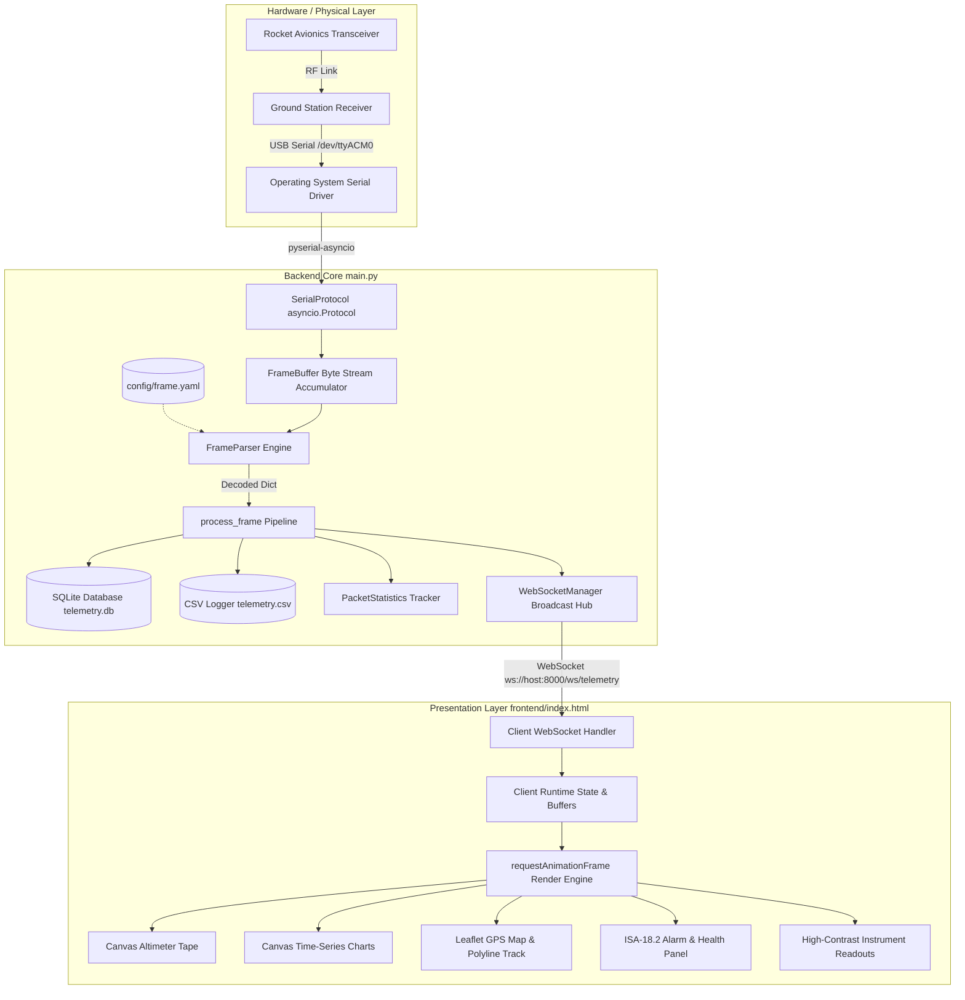
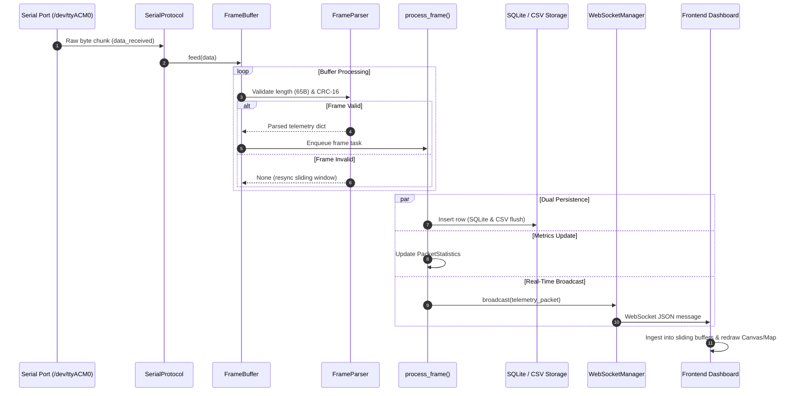
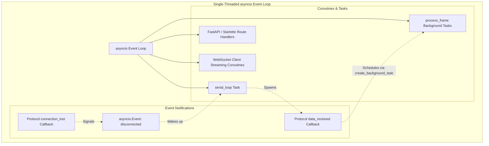
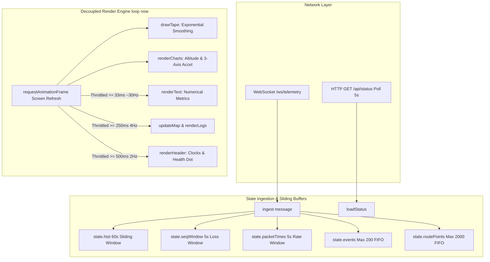

# System Architecture & Component Documentation

> **Language / Idioma:** [ 🇬🇧 English ](architecture.md) | [ 🇪🇸 Español ](es/architecture.md)  
> **Visual Reference:** [ 📊 Comprehensive Architectural Diagrams & Deep-Dive Reference ](architecture-diagrams.md)

This document describes the end-to-end system architecture, asynchronous concurrency model, data flow, and frontend rendering pipeline of the **Rocket Telemetry Ground Station** (`estacion-terrena-pc`).

---

## 1. System Overview

The Rocket Telemetry Ground Station is an asynchronous telemetry acquisition, validation, persistence, and real-time visualization platform. It receives binary telemetry streams from a rocket avionics transceiver over a serial interface (UART), parses and verifies packets dynamically against declarative YAML schemas, records flight data simultaneously to relational and flat-file storage, and streams decoded metrics to a low-latency web dashboard over WebSockets.



---

## 2. End-to-End Data Pipeline

The data ingestion path is engineered to decouple high-frequency byte stream acquisition from disk persistence and graphical rendering.



### 2.1 Serial Ingestion
- Telemetry enters via an asynchronous serial connection managed by `pyserial-asyncio` (`serial_asyncio.create_serial_connection`).
- The default interface is `/dev/ttyACM0` (Linux) or `COMx` (Windows) at `115200` baud.
- Low-level data chunks trigger `SerialProtocol.data_received(data: bytes)` on the active `asyncio` event loop without blocking thread execution.

#### 2.1.1 Physical RF Link & Radio Modems
- For wireless flight operations, the serial interface bridges directly to a physical RF transceiver (e.g. 433 MHz LoRa SX1278 module or SiK radio modems).
- The radio modem operates in transparent serial streaming mode, passing binary frames across the air link into the host OS USB-UART driver without altering frame contents.
- Over-the-air link budget analysis (SF7, BW 250 kHz, CR 4/5) results in a 61.57 ms Time-on-Air (ToA) per 65-byte frame, providing a 52.5% safety margin and 38.43 ms channel silence window per 100 ms transmission period at 10 Hz (detailed in [`docs/protocol.md`](protocol.md#2-lora-rf-modulation--time-on-air-toa-budget)).


### 2.2 Framing and Sliding Synchronization
- Raw chunks are appended to a sliding byte buffer in `FrameBuffer`.
- With the `0xAA` synchronization header configured, `FrameBuffer` rapidly indexes to the start of valid frames.
- If a candidate slice fails validation (invalid CRC or incorrect field structure), `FrameBuffer` cleanly discards the sync byte and searches for the next sync boundary, sliding through the stream without dropping genuine packets.

### 2.3 Declarative Parsing Engine
- `FrameParser` operates according to `config/frame.yaml`.
- The parser verifies:
  1. **Frame Length:** Validates exact 65-byte occupancy.
  2. **CRC-16/CCITT-FALSE Integrity:** Calculates CRC-16 over bytes 0 through 62 (polynomial `0x1021`, initial value `0xFFFF`, final XOR `0x0000`, no bit reflection). Compares the result with bytes 63–64.
  3. **Expected Values:** Verifies synchronization constants (`sync == 0xAA`).
  4. **Type Unpacking:** Translates binary fields according to their configured endianness (`little_endian`), extracting integers (`uint8`, `uint16`, `uint32`), floats (`float32`), or byte vectors.
  5. **Physical Scaling & Offsets:** Applies linear formulas ($Physical = Raw \times Scale + Offset$).
  6. **Enumeration Translation:** Maps discrete status codes to operational flight phases (`STANDBY`, `POWERED`, `BURNOUT`, `APOGEE`, `DROGUE_CONF`, `MAIN_CONF`, `LANDED`).

### 2.4 Dual Persistence Layer
Once parsed, `process_frame` records the packet simultaneously across two storage engines:
- **Relational SQLite Database (`data/telemetry.db`):**
  Records each packet in the `telemetry` table:
  ```sql
  CREATE TABLE IF NOT EXISTS telemetry (
      id INTEGER PRIMARY KEY AUTOINCREMENT,
      timestamp REAL NOT NULL,
      sequence INTEGER,
      payload TEXT NOT NULL
  );
  ```
  Indexed and queryable for post-flight telemetry analysis.
- **Flat-File CSV Logger (`data/telemetry.csv`):**
  Appends structured rows including the system timestamp, raw/scaled telemetry fields, and mapped label keys. Automatically writes headers upon file creation and flushes the buffer on every row write (`file.flush()`) to ensure no data loss occurs in the event of an abrupt power shutdown.

### 2.5 Real-Time WebSocket Broadcasting
- `WebSocketManager` maintains an active collection of connected browser clients (`set[WebSocket]`).
- Telemetry packets are formatted as JSON payloads containing the timestamp, packet statistics, CRC validation status, raw hex representation, and the parsed fields dictionary.
- Non-blocking concurrent broadcasting safely cleans up disconnected or broken client connections without disrupting the telemetry ingestion loop.

---

## 3. Concurrency and Asynchronous Model in `main.py`

The backend leverages Python's single-threaded cooperative multitasking model (`asyncio`) alongside **FastAPI** and **Uvicorn**, avoiding the thread-synchronization bottlenecks and race conditions common to multi-threaded serial pollers.



### 3.1 Non-Blocking Protocol/Transport Architecture
- Instead of running a blocking `serial.read()` loop inside an OS thread, the application implements `asyncio.Protocol` (`SerialProtocol`).
- When the operating system signals that bytes are available on the serial port descriptor, `asyncio` triggers `SerialProtocol.data_received`.
- Windows compatibility is maintained by selecting `asyncio.WindowsSelectorEventLoopPolicy()` when running on Win32 platforms.

### 3.2 Resilient Background Task Management
- Frame processing and client broadcasting are offloaded using `create_background_task(coroutine)`.
- Background tasks are stored in a module-level set (`background_tasks: set[asyncio.Task]`) to prevent Python's garbage collector from destroying coroutines mid-execution.
- Done callbacks automatically remove completed tasks from the set and log unhandled exceptions.

### 3.3 Automatic Reconnection State Machine
- `serial_loop()` executes continuously in the background.
- If the serial port cannot be opened (e.g., the USB cable is unplugged), the loop logs a warning, sleeps for `reconnect_delay` seconds (default: 3 seconds), and retries.
- While the connection is active, `serial_loop()` awaits `protocol.disconnected.wait()`.
- Upon connection loss, `SerialProtocol.connection_lost()` sets the `disconnected` event and broadcasts a `{"type": "connection", "connected": false}` message to all dashboard clients.
- The web server remains fully operational and responsive even when the serial hardware is disconnected.

### 3.4 Graceful Lifespan Shutdown
- Upon application shutdown (`@app.on_event("shutdown")`), the runtime:
  1. Sets `runtime.connected = False`.
  2. Cancels all pending background tasks and gathers their completion via `asyncio.gather(*tasks, return_exceptions=True)`.
  3. Closes SQLite database connections.
  4. Flushes and closes open CSV log file descriptors.

---

## 4. Frontend Web Architecture & Multi-View Suite

The ground station provides a multi-view operational web suite served directly from the `frontend/` directory:
- **Primary Mission Dashboard (`frontend/index.html` $\to$ `/`):** High-contrast telemetry console displaying the altimeter tape, real-time accelerations, GIS map, and ISA-18.2 style operational alarms.
- **Pre-Flight Qualification Console (`frontend/gonogo.html` $\to$ `/gonogo`):** Go / No-Go safety validation with stability hold timer and launchpad sensor baseline checks.
- **Tactical Search & Recovery View (`frontend/recovery.html` $\to$ `/recovery`):** SAR tactical view with real-time geodesic bearing, distance, mobile responsiveness, and one-click Google Maps coordinate dispatch.

All three views share zero runtime external dependencies, communicate over the unified WebSocket stream, and are optimized for direct sunlight readability.



### 4.1 Decoupled Execution and Multi-Tiered Throttling
To prevent UI freezing, DOM thrashing, and memory degradation under high packet rates, the dashboard separates network message ingestion from visual rendering:
- **Network Ingestion (`ingest`):** Runs immediately upon packet arrival, updating numeric fields and appending points to in-memory buffers.
- **Render Engine (`requestAnimationFrame`):** Executes in synchronization with the browser display refresh rate, dispatching updates according to fixed time budgets:
  - **Every Frame (~60 Hz):**
    - `drawTape()`: Renders the dynamic Canvas altimeter tape using an exponential moving average (`altDisplay += (altitude - altDisplay) * 0.35`) for fluid mechanical animation.
    - `renderCharts()`: Repaints time-series Canvas charts with dynamic time-window extrapolation.
  - **~30 Hz ($\ge 33\text{ ms}$ interval):**
    - `renderText()`: Updates primary tabular text metrics (current altitude, max altitude, tri-axial acceleration).
  - **4 Hz ($\ge 250\text{ ms}$ interval):**
    - `updateMap()`: Pans Leaflet map and updates GPS polyline coordinates.
    - `renderLogs()`: Evaluates ISA-18.2 style alarms, maintains 5-second packet loss windows, computes instantaneous RX rate, and renders the flight events list.
  - **2 Hz ($\ge 500\text{ ms}$ interval):**
    - `renderHeader()`: Updates local clock, Mission Elapsed Time (MET `T+ HH:MM:SS`), flight stage badge, and connection health indicators.

### 4.2 Zero-Dependency High-Performance Canvas Rendering
Rather than loading third-party charting bundles, the dashboard renders charts directly to HTML5 Canvas:
- **Retina/HiDPI Scaling:** `fitCanvas()` inspects `window.devicePixelRatio`, adjusting the backing canvas buffer size while preserving CSS bounding dimensions to eliminate pixelation on high-DPI displays.
- **Continuous Sliding Time-Window:** Charts display a fixed 60-second historical window (`CFG.windowMs = 60000`). The right-hand time boundary is calculated by `chartEnd()` as the latest packet timestamp plus elapsed local time (clamped to 250 ms) to prevent visual stepping between frames.
- **Zero-Anchored Dynamic Auto-Scaling:** `niceRange()` guarantees that $0$ is always visible as a reference baseline with a dashed zero-line, while dynamically accommodating peak values.
- **Flight Event Annotations:** Flight phase transitions are rendered as vertical dashed marker lines with high-contrast text badges directly across the oscilloscope canvas.

### 4.3 Interactive GIS and Trajectory Mapping
- Powered by **Leaflet 1.9.4** and OpenStreetMap tiles.
- The launch point is permanently marked with a green anchor circle (`startMarker`).
- The real-time vehicle position is updated via `state.marker` and automatically panned.
- Vehicle track is drawn via an interactive polyline (`state.route`), updated at 2 Hz to avoid map DOM thrashing.

### 4.4 ISA-18.2 Style Operational Alarm System
The alarm subsystem continuously monitors mission safety criteria and classifies findings into standardized priority badges:
- **CRITICAL (`crit`, `#b00020`):**
  - Serial link loss / silence exceeding 3.0 seconds (`ENLACE PERDIDO`).
  - Recent packet loss exceeding 15% across a 5-second sliding window (`ALTA PÉRDIDA DE PAQUETES`).
- **WARNING (`warn`, `#f2b400`):**
  - Communication degradation / silence exceeding 1.5 seconds (`ENLACE DEGRADADO`).
  - Recent packet loss exceeding 5% (`PÉRDIDA MODERADA`).
  - G-force magnitude exceeding 9.5 g on any single axis (`ACELERACIÓN CERCANA AL LÍMITE`).
- **INFO (`info`, `#1a4fd6`):**
  - Frame corruption / CRC checksum failures detected (`ERRORES DE CRC DETECTADOS`).
- **STABLE (`ok`, `#087a3b`):**
  - All systems nominal (`TODOS LOS SISTEMAS NOMINALES`).

### 4.5 Memory-Safe Sliding Window Buffers
To prevent heap exhaustion during multi-hour rocket operations:
- **Historical Chart Metrics (`pushHist`):** Points older than 60,000 ms relative to the current timestamp are spliced out (`list.splice(0, removeCount)`).
- **Recent Packet Loss (`seqWindow`):** Sequence checks are evaluated over a 5,000 ms sliding window. Entries older than 5 seconds are purged.
- **Packet Reception Rate (`packetTimes`):** Rolling packet arrival timestamps are pruned beyond a 5-second window.
- **Capped FIFO Collections:**
  - Flight events log (`state.events`): Capped at 200 entries.
  - Phase chart markers (`state.markers`): Capped at 30 entries.
  - GPS trajectory polyline (`state.routePoints`): Capped at 2,000 coordinate pairs.
- Heap allocation remains flat and strictly bounded over indefinite runtimes.

---

## 5. Related Documentation

- **[Frame Specification & Binary Protocol Reference](protocol.md):** 65-byte LoRa frame memory map, field data types, scales, RF ToA link budget, and CRC-16 specification.
- **[Frame Schema Specification](frame-schema.md):** Declarative YAML frame definition reference and active production schema.
- **[Dashboard Visual Specification](frontend-dashboard.md):** Telemetry dashboard UI layout, visual hierarchy, instrument wireframes, and ergonomic design guidelines.
- **[API & WebSocket Interface Specification](api.md):** REST endpoints, WebSocket schemas, connection lifecycle, and payload examples.
- **[Getting Started & Operations Guide](getting-started.md):** Setup, Linux serial permissions, runtime operation, and verification.
- **[Windows Executable Packaging](packaging-exe.md):** Compiling standalone Windows .exe using PyInstaller or GitHub Actions.
- **[Extended Calculations & Future Reference](future-calculations.md):** Mathematical models for Kalman filtering, variometer ($V_z$), and antenna tracking.
